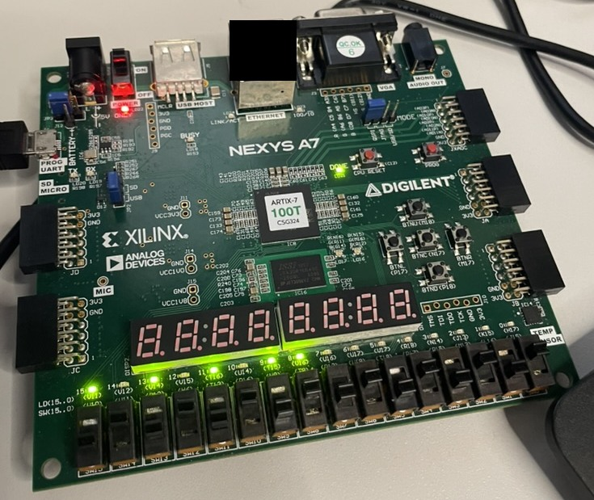
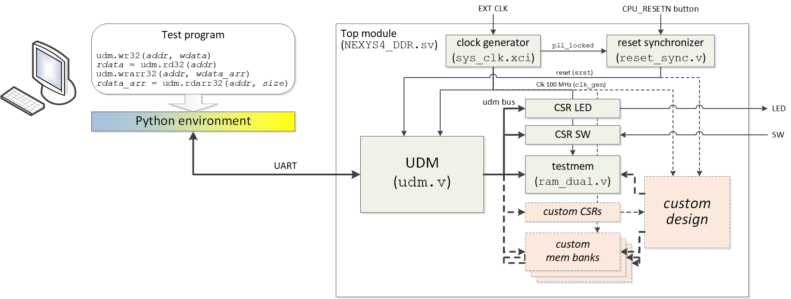
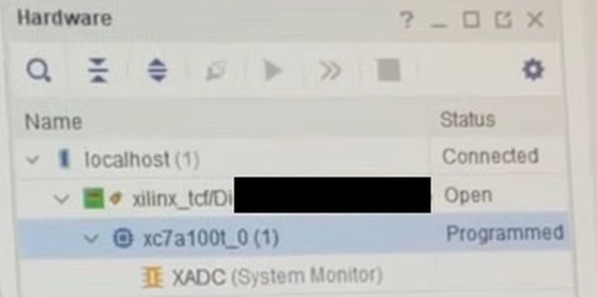
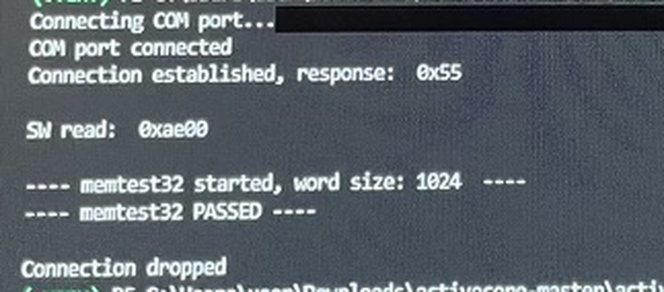
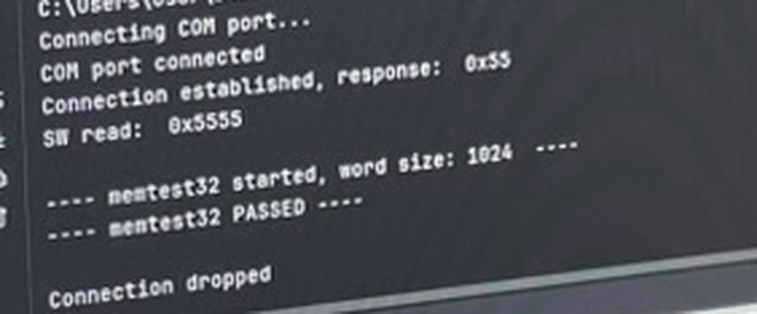
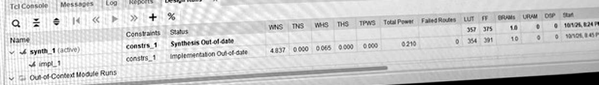

# Лабораторная работа № 1. Запуск базового проекта ActiveCore UDM на FPGA

## Задание и цель работы

Собрать и запустить базовый проект ActiveCore на плате Digilent Nexys A7-100T. Проверить, что ПК связывается с FPGA через UDM, может управлять светодиодами, считывать переключатели и записывать и читать тестовую память.

## Порядок выполнения

1. Изучить [лабораторное руководство](../designs/rtl/udm/doc/udm_lab_manual.pdf) и адресную карту базового проекта.
2. Открыть проект `NEXYS4_DDR.xpr` в Vivado, выполнить синтез и трассировку, сформировать bitstream.
3. Подключить плату, открыть Hardware Manager и запрограммировать FPGA через JTAG.
4. Настроить тестовый скрипт на последовательный порт платы, проверить ответ UDM и обмен с периферией.
5. Зафиксировать результаты натурного теста и характеристики реализации.

## Инструментальные средства

| Средство | Назначение |
|---|---|
| Digilent Nexys A7-100T, Artix‑7 XC7A100T, корпус CSG324 | Плата, использованная при натурном тесте. Проект ActiveCore называется `NEXYS4_DDR`. |
| Vivado Design Suite 2019.1 | Синтез, трассировка, генерация bitstream и загрузка через Hardware Manager. |
| Python 3, pySerial, скрипт `udm_test.py` | Доступ к регистрам и тест памяти по USB–UART на Windows. |

*Рисунок 1. Плата Nexys A7-100T и активный индикатор DONE.*

## Выполнение задания

### Функциональная модель и структура системы

UDM (UART-based Debug Module) принимает команды ПК через UART и преобразует их в транзакции внутренней 32-битной шины. При записи он передаёт адрес и данные, а при чтении возвращает данные выбранного регистра или слова памяти. Ответ `0x55` при проверке связи подтверждает обмен с UDM.

*Рисунок 2. Структура базового проекта из документации ActiveCore.*

Верхний модуль [`NEXYS4_DDR`](../designs/rtl/udm/syn/NEXYS4_DDR/NEXYS4_DDR.sv) соединяет UDM, регистры LED и SW и тестовую память. `sys_clk` формирует системный сигнал 100 МГц. `reset_sync` синхронизирует сброс с этим сигналом после захвата частоты. Тестовая память подключена к UDM одним портом, второй порт в базовом проекте отключён.

### Форматы данных и адресная карта

| Адрес | Доступ | Назначение |
|---|---|---|
| `0x00000000` | Чтение/запись | LED. Младшие 16 бит управляют светодиодами платы. |
| `0x00000004` | Чтение | SW. Состояние 16 переключателей возвращается в младших битах 32-битного слова. |
| `0x80000000…0x80000FFF` | Чтение/запись | `testmem`. 1024 слова по 32 бита, всего 4096 байт. |

Слова `testmem` адресуются с шагом 4 байта. Первое слово находится по `0x80000000`, последнее — по `0x80000FFC`.

### Симуляционный сценарий

Штатный [testbench UDM](../designs/rtl/udm/tb/tb.sv) выполняет проверку связи, сброс, запись шаблонов в тестовую память, запись в LED и чтение SW. Он описывает сценарий проверки базового проекта. В предоставленных материалах результаты запуска этого testbench отсутствуют. Фотографии симуляции `fp32_adder_tb` относятся к отдельному сумматору.

### Натурные испытания

После формирования bitstream в Hardware Manager устройство `xc7a100t_0` было отмечено как `Programmed`. На фото платы горит индикатор DONE.

*Рисунок 3. Состояние устройства после программирования.*

На фотографиях тестовый скрипт запускался с `COM5` на **921600 бод**. В [`udm_test.py`](../designs/rtl/udm/sw/udm_test.py) из ветки `lab1` порт по умолчанию — `COM1`. Номер порта задаётся для конкретного ПК.

1. Установить соединение и проверить ответ UDM.
2. Записать тестовое значение `0xAA55` в LED и прочитать состояние SW.
3. Запустить `memtest32` для 1024 слов с адреса `0x80000000`. Тест записывает массив случайных 32-битных слов, считывает его обратно и сравнивает все пары по индексам.

| Проверка | Наблюдение |
|---|---|
| Связь с UDM | В обоих запусках получен ответ `0x55`. |
| Чтение SW | В VS Code получено `0xAE00`, в PyCharm — `0x5555`. |
| Запись в LED | В скрипте запуска из VS Code видна запись `0xAA55`. Фото платы показывает включённые светодиоды, отдельная сверка их битовой маски в журнале отсутствует. |
| Запись и чтение `testmem` | В обоих запусках напечатано `memtest32 PASSED` для 1024 слов. |

*Рисунок 4. Ответ UDM, чтение SW и успешный тест 1024 слов в VS Code.*

*Рисунок 5. Повторная проверка UDM и тестовой памяти в PyCharm.*

### Характеристики аппаратуры

Входной период в XDC равен 10 нс. Выход `sys_clk` также настроен на **100 МГц**. В сохранённой строке `impl_1` на фото Vivado читаются следующие значения для всего проекта.

*Рисунок 6. Метрики сохранённого прогона Vivado.*

| Метрика | Значение |
|---|---:|
| Заданная частота | 100 МГц |
| WNS | +4,837 нс |
| TNS | 0,000 нс |
| LUT | 354 из 63 400 (0,56%) |
| FF | 391 из 126 800 (0,31%) |
| BRAM36 | 1 из 135 (0,74%) |

Проценты рассчитаны от ресурсов XC7A100T. [Справочные характеристики AMD для XC7A100T](https://www.amd.com/content/dam/amd/en/documents/university/vivado-teaching/hdl-design/2015x/Verilog/docs-pdf/Vivado_tutorial.pdf).

Положительный WNS и нулевой TNS относятся к сохранённому прогону. На фото его статус — `Implementation Out-of-date`, а в открытый проект уже добавлены исходники сумматора. Эти данные нельзя отнести к изменённому проекту или считать свежим отчётом для текущего коммита. В историческом `.xpr` ветки `lab1` указана цель `xc7a100tcsg324-3`. Для нового отчёта timing следует сверить speed grade с маркировкой установленной FPGA.

Базовый проект проверяет шинные транзакции, поэтому вычислительные показатели `II` и задержка ускорителя к этой работе не применяются. Задержка отдельного обмена и пропускная способность в операциях в секунду в натурном тесте не измерялись. 921600 бод — настройка последовательного соединения.

## Вывод

Базовый проект ActiveCore запрограммирован на Nexys A7-100T. Два натурных прогона подтвердили ответ UDM `0x55`, чтение переключателей и правильную запись с последующим чтением всех 1024 слов тестовой памяти. Цель запуска и проверки базового проекта достигнута. Числа Vivado относятся к сохранённому прогону и приведены вместе с его статусом.
