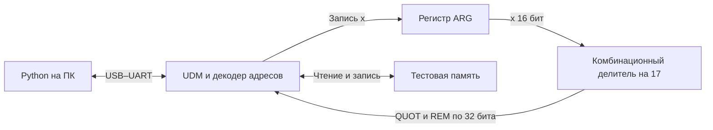
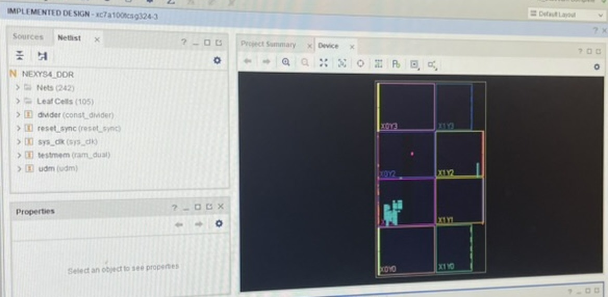
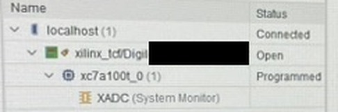
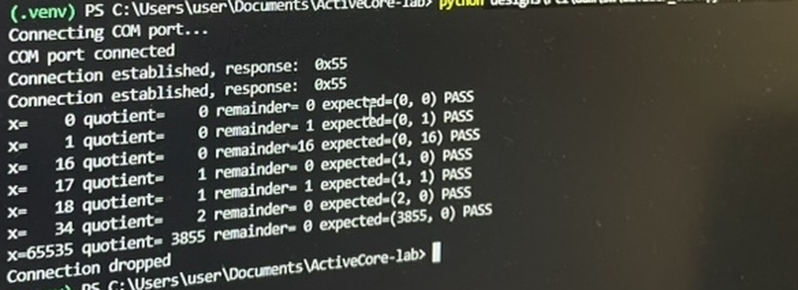
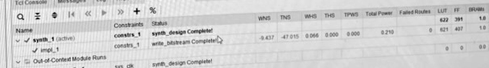

# Лабораторная работа № 2. Комбинационный делитель на 17

## Задание и цель работы

Вариант 3. Спроектировать, верифицировать и реализовать на FPGA комбинационный ускоритель деления беззнакового 16-битного числа `x` на 17. Выходы — частное `q = x // 17` и остаток `r = x % 17` в двух беззнаковых 32-битных словах. Для всех `x` от 0 до 65 535 должны выполняться условия `x = 17q + r` и `0 ≤ r < 17`.

## Порядок выполнения

1. Изучить эталонную Python-модель и определить форматы данных.
2. Реализовать комбинационный делитель и подключить его к регистрам UDM.
3. Проверить модель и RTL на всех входных значениях.
4. Выполнить синтез и трассировку в Vivado, сформировать bitstream и запрограммировать плату.
5. Проверить деление через USB–UART и проанализировать временные характеристики и ресурсы FPGA.

## Инструментальные средства

| Средство | Роль в работе |
|---|---|
| Digilent Nexys4-DDR с Artix‑7 XC7A100T | Целевая плата. Через JTAG загружается bitstream, через USB–UART выполняется обмен с UDM. |
| Vivado Design Suite 2019.1 | Синтез, размещение и трассировка, формирование bitstream и программирование через Hardware Manager. |
| Icarus Verilog | Исчерпывающий тест RTL-модуля. |
| Python 3 и pySerial | Эталонная модель, проверка арифметики и обмен с платой. |

## Выполнение задания

### Алгоритм и функциональная модель

Эталонная функция [`div17`](../variants/3-const_divider.py) реализует двоичное деление с условным вычитанием. Начальный промежуточный остаток `p` равен четырём старшим битам `x[15:12]`, начальное частное равно нулю. На каждой из 13 итераций определяется бит частного `b = (p ≥ 17)`. При `b = 1` из `p` вычитается 17. Затем выполняется `q ← 2q + b`. На первых 12 итерациях к остатку справа приписывается очередной бит аргумента, от `x[11]` до `x[0]`.

В модуле [`const_divider`](../designs/rtl/const_divider/const_divider.v) цикл с постоянным числом итераций находится в блоке `always @*`. При синтезе он разворачивается в комбинационную цепочку. Промежуточный результат одной итерации сразу служит входом следующей, поэтому последовательность сравнений, вычитаний и выбора результата определяет время распространения сигнала. Первое сравнение всегда даёт нулевой бит частного, поскольку `x[15:12] ≤ 15`. На выходах частное и остаток расширяются нулями до 32 бит.

### Структура системы

Верхний модуль [`NEXYS4_DDR`](../designs/rtl/udm/syn/NEXYS4_DDR/NEXYS4_DDR.sv) соединяет UDM, регистр аргумента, делитель, LED, SW и `testmem`. UDM принимает команды по UART и выполняет транзакции чтения и записи. При записи ARG системный регистр захватывает младшие 16 бит. Ядро вычисляет выходы по новому значению аргумента, а верхний модуль возвращает их в ответ на чтение соответствующих адресов.

*Рисунок 1. Иерархия реализованного проекта Nexys4-DDR и размещение на FPGA.*

### Форматы данных и адресная карта UDM

| Адрес | Доступ | Назначение |
|---|---|---|
| `0x00000000` | Чтение/запись | Регистр светодиодов LED. |
| `0x00000004` | Чтение | Регистр переключателей SW. |
| `0x00000010` | Чтение/запись | ARG. Аргумент в младших 16 битах 32-битного слова. |
| `0x00000014` | Чтение | QUOT. Частное в 32-битном слове. |
| `0x00000018` | Чтение | REM. Остаток в 32-битном слове. |
| `0x80000000…0x80000FFF` | Чтение/запись | `testmem`, 1024 слова по 32 бита. |

[`divider_test.py`](../designs/rtl/udm/sw/divider_test.py) записывает аргумент в ARG, затем читает QUOT и REM и сравнивает пару с `divmod(x, 17)`. Комбинационное ядро пересчитывает результат при изменении ARG. Для него не предусмотрены отдельный запуск и опрос готовности.

### Симуляционные тесты

| Проверка | Результат |
|---|---|
| Python-модель | Все 65 536 аргументов сверены с `divmod(x, 17)`. |
| RTL в Icarus Verilog | Все 65 536 аргументов сверены с независимыми выражениями `x / 17` и `x % 17`. |

Оба теста прошли в ветке `lab2`, что подтверждает совпадение результатов модели и RTL на всей области входных данных через общий арифметический эталон. В RTL проверяются оба выходных слова целиком, включая нулевое расширение. Команды и вывод приведены в [журнале симуляции](lab2-evidence/simulation.log). Интеграционный testbench UDM этой ветки вызывает `rd32_expect`, которого нет в подключённом классе `udm_driver`. Сквозной обмен в данном отчёте подтверждается натурным тестом.

### Натурный тест на Windows

Vivado Hardware Manager показал состояние `Programmed` для `xc7a100t_0`. После программирования Python-скрипт получил ответ UDM `0x55` и проверил приведённые ниже пары на плате.

*Рисунок 2. Запрограммированная FPGA в Vivado Hardware Manager.*

*Рисунок 3. Натурная проверка делителя через последовательный порт.*

| Аргумент `x` | Частное с платы | Остаток с платы | Результат |
|---:|---:|---:|---|
| 0 | 0 | 0 | PASS |
| 1 | 0 | 1 | PASS |
| 16 | 0 | 16 | PASS |
| 17 | 1 | 0 | PASS |
| 18 | 1 | 1 | PASS |
| 34 | 2 | 0 | PASS |
| 65535 | 3855 | 0 | PASS |

При отладке pySerial вывел [`Cannot configure port` с ошибкой Windows 87](lab2-evidence/06-windows-com-error.jpg), после чего очистка соединения вызвала вторичное исключение `AttributeError` для поля `ser`. Ошибка произошла до обмена с UDM. Какой параметр порта вызвал ошибку, по снимкам установить нельзя. На другом снимке Vivado показал [сообщения HDL 9-806 в `atan2_cordic.v`](lab2-evidence/01-cordic-warning.jpg). Этот файл относится к отдельному ускорителю. На снимке реализованного делителя в иерархии указан `divider (const_divider)`.

### Характеристики аппаратуры

В файле ограничений указан входной период 10 нс, то есть **100 МГц**. Параметры ниже взяты из строки `impl_1` в Vivado 2019.1 для цели `xc7a100tcsg324-3`, показанной в проекте ЛР2. Для повторной оценки следует указать speed grade по маркировке FPGA платы. В учебных материалах AMD для Nexys4-DDR указано устройство `xc7a100tcsg324-1`. [Ресурсы XC7A100T и выбор FPGA в Vivado](https://www.amd.com/content/dam/amd/en/documents/university/vivado-teaching/hdl-design/2015x/Verilog/docs-pdf/Vivado_tutorial.pdf).

*Рисунок 4. Показатели после реализации в Design Runs.*

| Показатель | Значение |
|---|---:|
| Заданная частота | 100 МГц |
| WNS | −9,437 нс |
| TNS | −47,015 нс |
| LUT | 621 из 63 400 (0,98%) |
| FF | 407 из 126 800 (0,32%) |
| BRAM36 | 1 из 135 (0,74%) |

Ресурсы указаны для всей системы, включая UDM и тестовую память. Отрицательные WNS и TNS показывают, что у этой сборки есть нарушения setup. Vivado [зафиксировал невыполнение временных требований](lab2-evidence/02-timing-warning.jpg), хотя стадия формирования bitstream завершилась.

Задержка ядра определяется временем распространения по комбинационной цепи. Собственного тактового сигнала и фиксированной задержки в тактах у ядра нет. На снимках отсутствует отчёт по конкретному пути от регистра ARG до захвата результата, поэтому отдельное измерение задержки ядра в секундах не приводится.

В синхронном окружении при достаточном периоде такта результат можно захватывать на следующем фронте, а новый аргумент подавать на каждом такте. В такой модели задержка равна одному такту, `II = 1` и расчётная пропускная способность равна `f_clk` операций в секунду. Для показанной реализации работоспособность при непрерывном запуске на 100 МГц не подтверждена. Скорость обмена с ПК также зависит от UART и числа транзакций UDM на одно деление.

## Вывод

Реализован комбинационный делитель на 17. Симуляция подтвердила соответствие Python-модели на всех 65 536 входах, а натурный тест — корректную выдачу частного и остатка для семи контрольных аргументов. Цель функциональной проверки достигнута. Временное требование 100 МГц для сборки на снимках не выполнено. Для оценки рабочей частоты нужны повторная реализация для FPGA установленного speed grade и отчёт по критическим путям.
