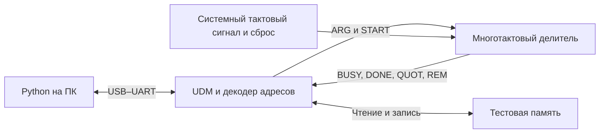
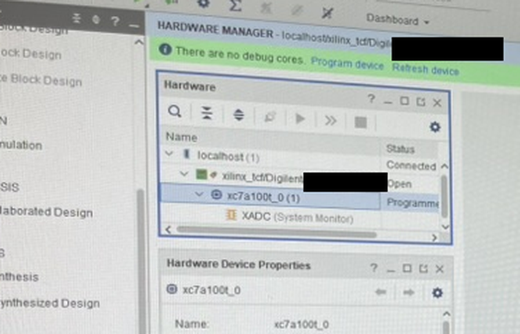
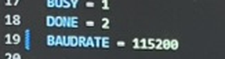
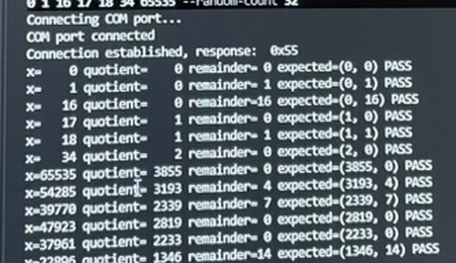
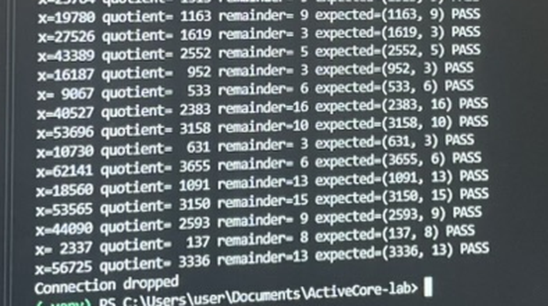
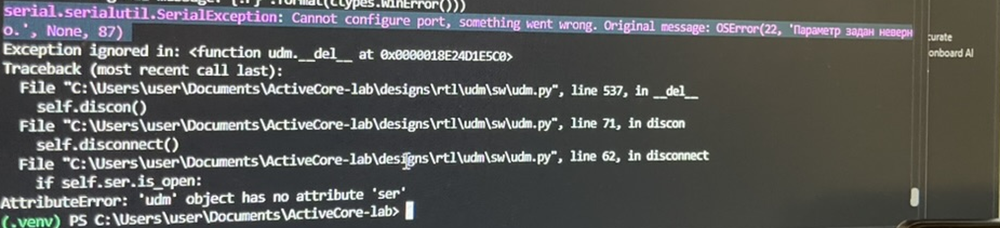

# Лабораторная работа № 3. Многотактовый делитель на 17

## Задание и цель работы

Вариант 3. Спроектировать, верифицировать и реализовать на FPGA многотактовый ускоритель деления беззнакового 16-битного числа `x` на константу 17. Ускоритель выдаёт частное `q = x // 17` и остаток `r = x % 17` в двух 32-битных словах. Для любого `x` из диапазона `0…65535` должны выполняться условия `x = 17q + r` и `0 ≤ r < 17`.

## Порядок выполнения

1. Определить форматы данных и проверить эталонную Python-модель.
2. Разделить алгоритм на такты и реализовать вычислительный тракт и управление.
3. Проверить вычисления, сигналы запуска и сброс в симуляции.
4. Подключить ускоритель к UDM, собрать проект для Nexys4-DDR и проверить обмен с платой.
5. Определить задержку, интервал запуска, расчётную пропускную способность и ресурсы FPGA.

## Инструментальные средства

| Средство | Роль в работе |
|---|---|
| Digilent Nexys4-DDR, Artix‑7 `xc7a100tcsg324-1` | Целевая плата. JTAG используется для программирования, USB–UART — для обмена через UDM. |
| Vivado Design Suite 2019.1 | Проект Nexys4-DDR и Hardware Manager для натурной проверки на Windows. |
| Python 3 и pySerial | Эталонная модель и обмен с платой. |
| Icarus Verilog 13.0, Verilator 5.052 | Полный перебор аргументов в RTL и интеграционная симуляция UART/UDM. |
| Yosys и openXC7 | Дополнительная сборка системы в режиме ЛР3. |

## Выполнение задания

### Алгоритм и функциональная модель

Модель [`div17`](../variants/3-const_divider.py) реализует двоичное деление с условным вычитанием. В начале вычисления четыре старших бита аргумента `x[15:12]` загружаются в промежуточный остаток `p`, а частичное частное `q` обнуляется. На каждой из 13 итераций вычисляется очередной бит частного `b = (p ≥ 17)`. Если `b = 1`, из `p` вычитается 17. Бит приписывается к частному по формуле `q ← 2q + b`. После первых 12 итераций остаток сдвигается влево с добавлением очередного бита аргумента, от `x[11]` до `x[0]`. После последней итерации сдвиг не выполняется. Первое сравнение всегда даёт нулевой бит частного, поскольку `x[15:12] ≤ 15`. Эта итерация сохранена для соответствия модели.

После условного вычитания остаток не превышает 16. Перед сравнением после очередного сдвига его максимальное значение равно `2 × 16 + 1 = 33`, поэтому достаточно 6 бит. Максимальное частное равно 3855, максимальный остаток равен 16. При выдаче результата оба значения расширяются нулями до 32 бит.

### Структура системы и управление

Верхний модуль [`NEXYS4_DDR`](../designs/rtl/udm/syn/NEXYS4_DDR/NEXYS4_DDR.sv) соединяет UDM, регистры, тестовую память и делитель. Параметр `DIVIDER_MULTICYCLE=1` выбирает реализацию ЛР3. Модуль [`const_divider_multicycle`](../designs/rtl/const_divider/const_divider_multicycle.v) выполняет одну итерацию за такт. В нём один блок сравнения и вычитания работает с регистрами промежуточного остатка, частного и оставшихся битов аргумента. Счётчик от 0 до 12 задаёт номер итерации.

На фронте `t0` принятый `START` фиксирует аргумент, устанавливает `BUSY` и сбрасывает `DONE`. На фронтах `t1…t13` выполняются итерации. На `t13` записываются оба результата, `BUSY` сбрасывается, а `DONE` устанавливается. Новый запуск можно принять на `t14`. Запуск при `BUSY=1` игнорируется. `DONE` сохраняется до принятия нового запуска или сброса. Регистры результата сохраняют предыдущую завершённую пару до готовности следующей. Сброс прерывает расчёт и обнуляет состояние и результаты.

### Форматы данных и адресная карта

| Адрес | Доступ | Назначение |
|---|---|---|
| `0x00000000` | Чтение/запись | Регистр светодиодов LED. |
| `0x00000004` | Чтение | Регистр переключателей SW. |
| `0x00000010` | Чтение/запись | ARG. Аргумент в младших 16 битах 32-битного слова. |
| `0x00000014` | Чтение | QUOT. 32-битное частное последней завершённой операции. |
| `0x00000018` | Чтение | REM. 32-битный остаток последней завершённой операции. |
| `0x0000001C` | Запись, при чтении `0` | CTRL. Запись единицы в бит 0 формирует импульс `START`. |
| `0x00000020` | Чтение | STATUS. Бит 0 — `BUSY`, бит 1 — `DONE`, остальные биты равны нулю. |
| `0x80000000…0x80000FFF` | Чтение/запись | Тестовая память `testmem` объёмом 1024 слова по 32 бита. |

Программа записывает аргумент в ARG и запускает деление записью `1` в CTRL. Как только опрос STATUS даёт `DONE=1` и `BUSY=0`, программа читает QUOT и REM. Передача по UART и опрос регистров увеличивают время операции со стороны ПК.

### Симуляционные тесты

[Журнал верификации ЛР3](../designs/rtl/const_divider/tb/results/lab3_verification.log) содержит результаты следующих проверок.

| Проверка | Результат |
|---|---|
| Полный перебор на Icarus Verilog | Для всех 65 536 аргументов пары `(q, r)` побитово совпали с векторами Python-модели. Независимая проверка через `/ 17` и `% 17` также прошла. |
| Управление и временные параметры | Подтверждены задержка 13 тактов и минимальный интервал запуска 14 тактов. Проверены фиксация аргумента, повторный `START` при занятости, сохранение результата и сброс во время вычисления. |
| Интеграционная симуляция Verilator | Прошли 25 делений через UART/UDM в режиме ЛР3, а также проверки сброса, регистров платы и `testmem`. |
| Python | В журнале зафиксировано прохождение шести тестов модели и программы обмена. |

Для просмотра сигналов сохранена [временная диаграмма VCD](../designs/rtl/const_divider/tb/results/lab3_directed.vcd). Повторить симуляцию из корня `lab3` можно командой `python3 variants/check_lab3.py --integration`.

### Натурный тест на Windows

В Vivado Hardware Manager целевое устройство `xc7a100t_0` отмечено как запрограммированное. В успешном запуске [`divider_test.py`](../designs/rtl/udm/sw/divider_test.py) использовался режим `multicycle` со скоростью UART **115200 бод**. Ответ `0x55` подтвердил связь с UDM. Тест сравнивал считанные частное и остаток с `divmod(x, 17)`.

*Рисунок 1. Программирование FPGA в Vivado Hardware Manager.*

*Рисунок 2. Настройка скорости UART в экземпляре скрипта, показанном на фото.*

*Рисунок 3. Ответ `0x55` и начало успешного прогона.*

| `x` | Частное с платы | Остаток с платы | Результат |
|---:|---:|---:|---|
| 0 | 0 | 0 | PASS |
| 1 | 0 | 1 | PASS |
| 16 | 0 | 16 | PASS |
| 17 | 1 | 0 | PASS |
| 18 | 1 | 1 | PASS |
| 34 | 2 | 0 | PASS |
| 65535 | 3855 | 0 | PASS |

В командной строке указаны эти семь аргументов и `--random-count 32`. На фото видны `PASS` для семи заданных аргументов и ряда случайных значений. Конец вывода показывает закрытие соединения и возврат в PowerShell. Полный журнал с каждой случайной проверкой не приложен, поэтому число 32 характеризует параметры теста.

*Рисунок 4. Последние проверки случайных аргументов.*

При первой попытке Windows отклонила настройки `COM3` с ошибкой 87 (`Cannot configure port`). Затем при очистке программа попыталась обратиться к `ser`, хотя последовательное соединение ещё не было создано. Ошибка произошла до обмена с UDM. Из имеющихся снимков нельзя установить, какой параметр вызвал ошибку 87.

*Рисунок 5. Диагностика подключения перед успешным прогоном.*

### Характеристики аппаратуры

| Характеристика ядра | Значение | Основание |
|---|---:|---|
| Заданная частота | 100 МГц | Настройка проекта. |
| Задержка | 13 тактов | От принятия `START` до обновления результата, по симуляции. |
| Задержка при 100 МГц | 130 нс (`1,30 × 10⁻⁷ с`) | `13 × 10 нс`. |
| Интервал запуска `II` | 14 тактов | Между фронтами принятия соседних операций, по симуляции. |
| Пропускная способность ядра при 100 МГц | ≈ 7,14 млн операций/с | `100 000 000 / 14`, при подаче следующего запуска сразу после готовности. |

**Дополнительная сборка openXC7.** В дереве `lab4` (`06c7149`) собран тот же RTL-модуль делителя в режиме `multicycle`. В этой сборке применён прямой тактовый сигнал платы 100 МГц, а проект Vivado использует Clocking Wizard. Статистика относится ко всей системе, включая UDM и `testmem`. Количество LUT подсчитано по примитивам синтезированной схемы до упаковки. Единственный BRAM36 используется для `testmem`. [Извлечение из локальных отчётов openXC7](lab3-evidence/openxc7-multicycle.txt).

| Метрика openXC7 | Значение |
|---|---:|
| Оценка Fmax после трассировки | 182,98 МГц при проверяемом требовании 100 МГц |
| LUT | 646 из 63 400 (1,02%) |
| FF | 468 из 126 800 (0,37%) |
| BRAM36 | 1 из 135 (0,74%) |

**Данные Vivado после трассировки.** Фотография Hardware Manager подтверждает программирование, а значения ниже нужно взять из отчётов повторной сборки режима `multicycle`.

| Метрика | Значение | Источник для заполнения |
|---|---|---|
| Частота `clk_gen`, МГц | 100 задано | `clocks.rpt` и `timing_summary.rpt` |
| WNS, нс | Ожидается отчёт | `timing_summary.rpt` |
| TNS, нс | Ожидается отчёт | `timing_summary.rpt` |
| LUT, шт. / % | Ожидается отчёт | `utilization.rpt` |
| FF, шт. / % | Ожидается отчёт | `utilization.rpt` |
| BRAM, шт. / % | Ожидается отчёт | `utilization.rpt`, с указанием единиц учёта BRAM |

Для повторной проверки сохранить журнал обмена на macOS с портом и скоростью, идентификатором сборки, перечнем входов и итогами прогона. Для метрик Vivado сохранить отчёты из `reports/multicycle/`, полученные командой `vivado -mode batch -source build_windows.tcl -tclargs multicycle` из каталога проекта Vivado. Затем дополнить таблицу и уточнить вывод по частоте.

## Вывод

Реализован многотактовый делитель на 17, который повторно использует один вычислительный блок. В RTL подтверждены правильность результатов для всех 65 536 аргументов, задержка 13 тактов и интервал между запусками 14 тактов. Натурный тест на Windows подтвердил связь с платой по UDM и правильность деления для показанных граничных и случайных значений. Повторный прогон на macOS и отчёты Vivado после трассировки дополнят результаты натурной проверки и оценки ресурсов.
