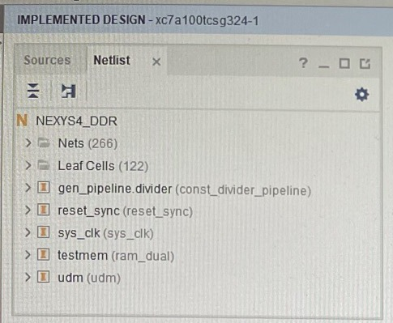
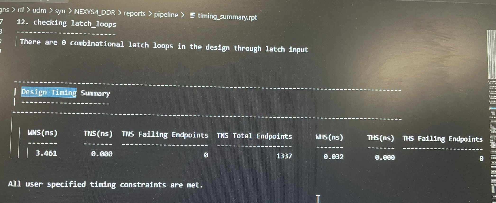
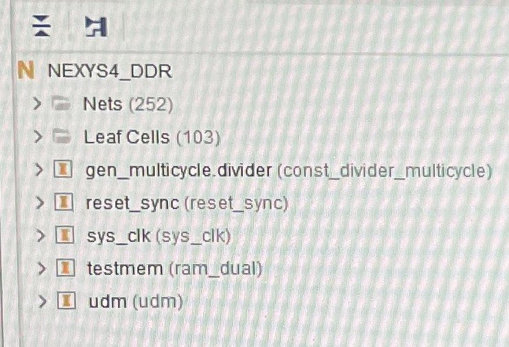
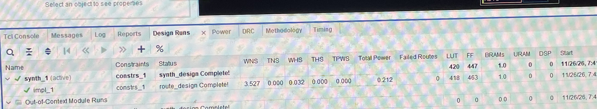
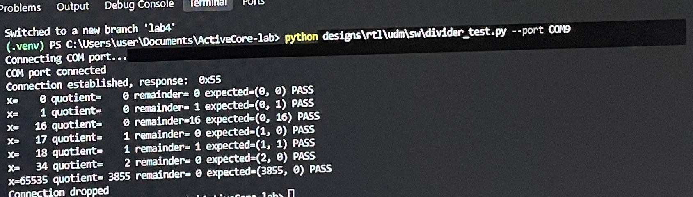

# Лабораторная работа № 4. Конвейерный делитель на 17

## Задание и цель работы

Вариант 3. Спроектировать, проверить и реализовать на FPGA конвейерный делитель беззнакового 16-битного числа `x` на 17. Результат — два беззнаковых 32-битных слова: частное `q` и остаток `r`. Для всех входов выполняются `x = 17q + r` и `0 ≤ r < 17`.

## Порядок выполнения

1. Разбить алгоритм деления на ступени и определить момент готовности результата.
2. Реализовать конвейер, подключить регистры UDM и проверить вычисления в симуляции.
3. Собрать bitstream, загрузить его на плату и проверить деление через UART.
4. Сопоставить временные параметры и ресурсы с предыдущими реализациями.

## Инструментальные средства

Nexys A7-100T с Artix‑7 XC7A100T, Yosys и openXC7 для сборки под `xc7a100tcsg324-1`, openFPGALoader для программирования из macOS, Python и pySerial для обмена по USB–UART. Для симуляции использовались Icarus Verilog и Verilator. Для отдельного запуска подготовлен проект Vivado.

## Выполнение задания

### Алгоритм и структура

В [эталонной модели](../variants/3-const_divider.py) четыре старших бита задают начальный остаток. Первое сравнение с 17 всегда даёт ноль, поскольку эти четыре бита образуют число от 0 до 15. Для младших 12 бит в [RTL](../designs/rtl/const_divider/const_divider_pipeline.v) выделено по одной ступени. Каждая ступень формирует `trial = 2r + bit`, при `trial ≥ 17` вычитает 17 и добавляет единицу к сдвинутому частному. Иначе она сохраняет `trial` и добавляет ноль.

Между ступенями регистрируются частичное частное, остаток, оставшиеся биты аргумента и признак действительных данных. Каждый вход с `valid_i=1` получает результат через 12 периодов, в порядке поступления. Синхронный сброс очищает признаки действительности для всех незавершённых операций.

### Форматы данных и адресная карта

| Адрес | Доступ | Назначение |
|---|---|---|
| `0x00` | Чтение/запись | LED. |
| `0x04` | Чтение | SW. |
| `0x10` | Чтение/запись | ARG, младшие 16 бит аргумента. |
| `0x14` | Чтение | QUOT, 32-битное частное. |
| `0x18` | Чтение | REM, 32-битный остаток. |
| `0x1C` | Запись | CTRL. Запись 1 даёт START при `BUSY=0`. |
| `0x20` | Чтение | STATUS. Биты 2, 1 и 0 — PIPELINE, DONE и BUSY соответственно. |
| `0x80000000…0x80000FFF` | Чтение/запись | `testmem`, 1024 слова по 32 бита. |

UDM подаёт аргументы по одному и хранит завершённую пару для чтения. Регистры QUOT и REM обновляются через 13 тактов после принятого START, на один такт позже выхода ядра.

### Симуляционные и натурные тесты

В RTL-симуляции все 65 536 аргументов поданы подряд, по одному за такт. Пары совпали с Python-моделью и независимой проверкой делением и остатком. Проверены порядок результатов, пропуски входов и сброс заполненного конвейера. Интеграционный тест Verilator прошёл 25 делений через UART/UDM. [Сценарий симуляции](../variants/check_lab3.py) и [временная диаграмма](../designs/rtl/const_divider/tb/results/lab4_directed.vcd).

26.11.2026 прошивка openXC7 загружена через JTAG в SRAM Nexys A7-100T. openFPGALoader сообщил `isc_done 1` и `done 1`. На macOS скрипт запущен в режиме `pipeline` при 115200 бод. После ответа UDM `0x55` пройдены **40 из 40** проверок, включая 8 контрольных и 32 случайных аргумента. Например, для 65534 плата выдала `(3854, 16)`, а для 65535 — `(3855, 0)`. Все пары совпали с `divmod(x, 17)`. [Полный журнал натурного прогона](lab4-evidence/board-macos.log).

### Характеристики аппаратуры

| Характеристика | Результат |
|---|---:|
| Заданная частота | 100 МГц |
| Fmax по трассировке openXC7 | 194,89 МГц |
| Критический путь openXC7 | 5,13 нс |
| Задержка ядра | 12 тактов, 120 нс при 100 МГц |
| Интервал запуска ядра | II = 1 такт |
| Пропускная способность ядра при 100 МГц | До 100 млн операций/с при непрерывной подаче |
| LUT | 665 из 63 400 (1,05%) |
| FF | 515 из 126 800 (0,41%) |
| BRAM36 | 1 из 135 (0,74%) |

Ресурсы относятся ко всему проекту с UDM и тестовой памятью. LUT подсчитаны по примитивам после синтеза, до упаковки. При той же цели 100 МГц многотактовый проект ЛР3 использовал 646 LUT и 468 FF и принимал операцию каждые 14 тактов. В ЛР4 дополнительные регистры позволяют обрабатывать несколько аргументов одновременно. [Сравнение сборок и источники](../lab.md#реализация-и-характеристики-на-fpga).

### Итоговая сборка конвейера в Vivado 2019.1

В реализованной схеме для `xc7a100tcsg324-1` виден модуль `gen_pipeline.divider (const_divider_pipeline)`. Метрики взяты из `reports/pipeline` после трассировки (`impl_1`).

| Показатель Vivado | Значение |
|---|---:|
| Заданная частота | 100 МГц |
| WNS | +3,461 нс |
| TNS | 0,000 нс |
| WHS | +0,032 нс |
| THS | 0,000 нс |
| LUT | 477 из 63 400 (0,75%) |
| FF | 520 из 126 800 (0,41%) |
| BRAM36 | 1 из 135 (0,74%) |

Vivado сообщил, что все заданные пользователем временные ограничения выполнены. Как и в openXC7, ресурсы указаны для всей системы.

Данные о ресурсах видны в [utilization.rpt, IMG_0852](lab4-evidence/vivado-pipeline-utilization.jpg) и в [строке impl_1, IMG_0850](lab4-evidence/vivado-pipeline-design-runs.jpg).

### Предварительный прогон многотактового режима в Vivado на Windows

На фотографиях из сеанса ЛР4 открыта ветка `lab4`, но в реализованной схеме Vivado выбран **многотактовый делитель**. В иерархии виден `gen_multicycle.divider (const_divider_multicycle)`, а на снимке симуляции — `DIVIDER_PIPELINE=0`. Выбор Git-ветки сам по себе не меняет параметры проекта Vivado.

По строке `impl_1` на снимке `IMG_0839` после трассировки получены WNS **+3,527 нс**, TNS **0,000 нс**, **418 LUT**, **463 FF** и **1 BRAM36**. Эти значения относятся к многотактовой сборке всей системы.

На Windows тест получил ответ UDM `0x55` и показал семь строк `PASS`. На фото команда запущена без `--mode pipeline`, поэтому для этого запуска проверка бита `PIPELINE` не выполнялась. Результаты Windows приведены отдельно от подтверждённого конвейерного прогона на macOS.

## Вывод

Конвейерный делитель реализован и проверен на FPGA. Натурный тест подтвердил корректность 40 операций через UDM, а симуляция — побитовое совпадение для всех 65 536 входов и приём нового аргумента каждый такт. Сборка openXC7 удовлетворила ограничению 100 МГц. Итоговая сборка конвейера в Vivado также выполнила заданные временные ограничения при 100 МГц.
