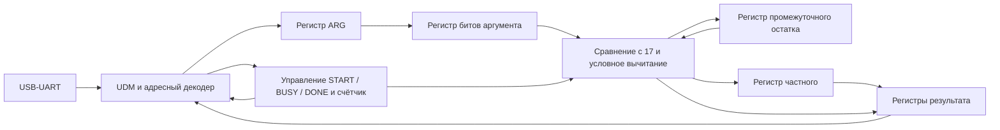

# Лабораторные работы и инструкция демонстрации

Текущая реализация по умолчанию — **ЛР3, многотактовый делитель на 17 (вариант 3)**.
Раздел ЛР2 описывает сохранённый комбинационный режим; инструкции ЛР3 и
результаты локальной верификации приведены в конце файла.

## Общие требования курса

Лабораторные работы
Запустить baseline-проект на FPGA (см. Лабораторное руководство, пп. 1-2)
Спроектировать, верифицировать и реализовать на FPGA комбинационную реализацию ускорителя прикладной функции (согласно варианту, с побитовым соответствием Python-модели)
Спроектировать, верифицировать и реализовать на FPGA многотактовую реализацию ускорителя прикладной функции (вариант тот же)
Спроектировать, верифицировать и реализовать на FPGA конвейерную реализацию ускорителя прикладной функции (вариант тот же)

Варианты заданий:

1 Сопоставление с образцом (количество)
Описание: определить количество вхождений подстроки в строке.
Входные данные: строка из 16x символов (4x 32-битных регистров), образец из 4x символов (1x 32-битный регистр)
Выходные данные: количество вхождений (32-битное целое число)

2 Сопоставление с образцом (последнее вхождение)
Описание: определить позицию последнего вхождения подстроки в строке.
Входные данные: строка из 16x символов (4x 32-битных регистров), образец из 4x символов (1x 32-битный регистр)
Выходные данные: позиция последнего вхождения (32-битное целое число)

3 Делитель на константу
Описание: получить частное и остаток путем деления числа на 17.
Входные данные: значение аргумента (16-битное целое число)
Выходные данные: частное и остаток (2x 32-битных числа)

4 Матричный умножитель
Описание: выполнить умножение матриц
Входные данные: матрица x (8x 32-битных целых чисел), матрица y (8x 32-битных целых чисел, транспонированные)
Выходные данные: умноженная матрица (4x 32-битных целых числа)

5 Сумматор с плавающей точкой
Описание: выполнить сложение значений с плавающей запятой
Входные данные: 2x 32-битных значения (IEEE-754)
Выходные данные: 1x 32-битное значение (IEEE-754)

6 Квадратный корень
Описание: вычислить квадратный корень из значения
Входные данные: значение аргумента (32-битное целое число)
Выходные данные: значение квадратного корня (32-битное целое число)

7 Кубический корень
Описание: вычислить кубический корень из значения
Входные данные: значение аргумента (32-битное целое число)
Выходные данные: значение кубического корня (32-разрядное целое число)

8 Битонная сортировка
Описание: сортировка массива значений
Входные данные: массив значений (8x 32-битных целых чисел)
Выходные данные: отсортированный массив значений (8x 32-битных целых чисел)

9 Косинус (ряд Тейлора)
Описание: генерировать значение функции cos(x), используя первые четыре члена ряда Тейлора.
Входные данные: значение аргумента (32 бит, фиксированная точка: 0x0000.0000)
Выходные данные: значение косинуса (32 бит, фиксированная точка: 0x0000.0000)

10 Арктангенс atan2 (CORDIC)
Описание: генерировать значение арктангенса atan2(y,x) с помощью метода CORDIC.
Входные данные: значение аргументов y, x (2x 32-битных целых числа, интерпретируемых как фиксированная точка: 0x0000.0000)
Выходные данные: значение косинуса (32-битное целое число, интерпретируемое как фиксированная точка: 0x0000.0000)


Python-модели:
папка variants в директории проета

Содержание отчетов по практическому заданию

Задание [цель работы]
Порядок [план, задачи] выполнения
Инструментальные средства (САПР, аппаратура, и т.д.)
Выполнение задания
описание целевого алгоритма/функциональной модели
структура разработанной системы, функциональное назначение модулей
форматы входных и выходных данных, адресная карта контрольно-статусных регистров и блоков памяти для взаимодействия с модулем
описание симуляционных и натурных тестов
характеристики разработанной аппаратуры:
тактовая частота: MHz; TNS, WNS;
пропускная способность: initiation interval, операций в секунду;
задержка: такт, секунд;
потребляемые ресурсы ПЛИС: LUT (табличные преобразователи), FF (регистры), BRAM (память); абсолютные значения и % от доступных.
Вывод. Оценка достижения целей работы


Материалы для выполнения лабораторных:

Рабочая плата: Digilent Nexys4-DDR (Artix-7 FPGA):
https://store.digilentinc.com/nexys-4-ddr-artix-7-fpga-trainer-board-recommended-for-ece-curriculum/
САПР для симуляции и имплементации: Vivado Design Suite 2019.1 (WebPack, бесплатная версия)
Для взаимодействия с платой: нужен дистрибутив WinPython с установленным пакетом pyserial


Презентации к лекциям:
https://disk.yandex.ru/d/Ao5bleQyeEk4FA

Практические материалы (baseline-проект для FPGA):

Baseline-проект для FPGA
этот репозиторий

Лабораторное руководство по использованию baseline-проекта для FPGA:

activecore/designs/rtl/udm/doc/udm_lab_manual.pdf


---

# Лабораторная №2: комбинационная реализация варианта 3

## Цель

Реализовать комбинационный ускоритель для варианта 3: получить частное и остаток
от деления беззнакового 16-битного числа `x` на константу `17`.

`q = x / 17`, `r = x % 17`, `0 <= r < 17`.

## Функциональная модель и RTL

Эталонная модель находится в [`variants/3-const_divider.py`](variants/3-const_divider.py).
Она использует восстанавливающий алгоритм деления: сначала загружаются четыре
старших бита, затем выполняются тринадцать шагов сдвига, сравнения с 17 и
вычитания. Сравнение выполняется как `partial_remainder >= 17`, поэтому точные
кратные 17 обрабатываются правильно.

RTL находится в [`const_divider.v`](designs/rtl/const_divider/const_divider.v). Вход
`dividend_i[15:0]` и выходы `quotient_o[31:0]`, `remainder_o[31:0]` образуют
полностью комбинационный интерфейс. В 32-битные слова результат дополняется
нулями; фактическая ширина входного аргумента — 16 бит.

## Проверка

[`const_divider_tb.sv`](designs/rtl/const_divider/tb/const_divider_tb.sv) перебирает
все `65536` входных значений и сравнивает RTL с `/ 17` и `% 17`.
[`test_3_const_divider.py`](variants/test_3_const_divider.py) выполняет
такую же проверку Python-модели.

На macOS без установленного Vivado/Verilog-симулятора доступна проверка Python:

```text
python3 -m unittest variants/test_3_const_divider.py
```

В Vivado можно запускать `const_divider_tb` как отдельный simulation set либо использовать интеграционный UDM testbench из проекта.

## Подключение к UDM

В baseline Nexys4-DDR сохранены исходные адреса LED, переключателей и testmem.
Для делителя добавлены:

| Адрес | Доступ | Назначение |
|---|---|---|
| `0x00000010` | `rw` | записать `x[15:0]`; расчет комбинационный |
| `0x00000014` | `r` | частное `x / 17` |
| `0x00000018` | `r` | остаток `x % 17` |

После записи аргумента результат можно читать сразу следующими UDM-транзакциями;
отдельный регистр запуска и ожидание готовности не требуются.

## Переносимый запуск ЛР2 на Windows

Для ЛР2 требуется `DIVIDER_MULTICYCLE=0` и параметр Python `--mode comb`.
Сборка по умолчанию теперь относится к ЛР3.

Подробный сценарий с названиями кнопок Vivado, настройкой PyCharm и разбором
зависания Python приведен в следующем разделе этого файла.

1. Скопировать весь репозиторий в любую папку Windows.
2. Открыть `designs/rtl/udm/syn/NEXYS4_DDR/NEXYS4_DDR.xpr` в Vivado 2019.1.
   Исходники подключены относительными путями.
3. Для пакетной сборки выполнить из Vivado Tcl:

   ```text
   set lab_divider_mode comb
   source [file join [get_property DIRECTORY [current_project]] build_windows.tcl]
   ```

   Либо запустить `vivado -mode batch -source build_windows.tcl` из каталога
   `syn/NEXYS4_DDR`, добавив `-tclargs comb`; скрипт сам вычисляет свои пути.
4. Сгенерированный `NEXYS4_DDR.bit` прошить через Hardware Manager.
5. Установить WinPython и `pyserial`, подключить плату и выполнить:

   ```text
   python designs/rtl/udm/sw/divider_test.py --mode comb
   ```

   Если Windows видит несколько COM-портов, указать нужный явно:

   ```text
   python designs/rtl/udm/sw/divider_test.py --port COM5 --mode comb
   ```

   Скрипт автоматически выбирает единственный найденный порт, поэтому номер
   COM и абсолютные пути не хранятся в проекте.

## Аппаратные характеристики

Точные timing/resource-метрики зависят от запуска Vivado 2019.1 на целевой
плате и должны быть взяты из отчетов `report_timing_summary` и
`report_utilization` после implementation. Их нельзя достоверно получить на
macOS без Vivado и они не подменяются расчетными значениями.


---

# Показ лабораторной на Windows: Nexys4-DDR, Vivado и Python

Эта инструкция описывает показ ЛР3 для варианта 3
(многотактовое деление на 17). Для сохранённой ЛР2 выберите при сборке режим
`comb`, а Python запускайте с `--mode comb`. Номер COM-порта не является
частью проекта: на каждом компьютере его нужно определить заново и передать
скрипту параметром.

## 1. Что делает каждая программа

Есть два разных соединения с платой:

1. **Vivado Hardware Manager и JTAG** — загружает `.bit` в FPGA.
2. **Python и UDM через USB-UART** — после прошивки отправляет команды чтения и
   записи в регистры ускорителя.

Python не прошивает FPGA. Вызов `udm.check()` отправляет запрос и ждет ответ
UDM. Если запустить Python до загрузки bitstream, ответ не придет и программа
будет выглядеть как зависшая. Это не этап отладки алгоритма; остановите такой
запуск `Ctrl+C`, сначала прошейте плату, затем повторите тест.

## 2. Подготовка Windows

Установите:

- Vivado Design Suite 2019.1 WebPACK или установленную в вашей лаборатории
  версию;
- Python 3 или WinPython;
- пакет `pyserial`.

В PowerShell из корня репозитория можно создать отдельное окружение:

```powershell
py -3 -m venv .venv
.\.venv\Scripts\Activate.ps1
python -m pip install --upgrade pip
python -m pip install pyserial
```

Если PowerShell запрещает запуск `Activate.ps1`, можно не активировать
окружение, а запускать его интерпретатор напрямую:

```powershell
.\.venv\Scripts\python.exe -m pip install pyserial
.\.venv\Scripts\python.exe designs\rtl\udm\sw\divider_test.py --help
```

В PyCharm выберите `File -> Open` и откройте **корень репозитория**, а не только
папку `sw`. В `Settings -> Project -> Python Interpreter` выберите
`.venv\Scripts\python.exe`.

## 3. Определение COM-порта

1. Подключите Nexys4-DDR кабелем USB.
2. Откройте `Диспетчер устройств` (`devmgmt.msc`).
3. Раскройте `Порты (COM и LPT)`.
4. Запомните номер порта платы, например `COM5`.
5. Если список изменился после отключения кабеля, используйте новый номер.

Не редактируйте `udm.py` и не заменяйте в нем `COM1`: тестовый скрипт принимает
порт параметром. Если найден ровно один последовательный порт, он выбирается
автоматически; при нескольких портах укажите его явно:

```powershell
python designs\rtl\udm\sw\divider_test.py --port COM5
```

COM-порт может быть занят открытым Serial Monitor, другой копией Python,
PuTTY или терминалом. Перед тестом закройте такие программы.

## 4. Открытие проекта Vivado

1. Запустите **Vivado 2019.1**.
2. Нажмите `Open Project`.
3. Откройте файл:

   ```text
   designs\rtl\udm\syn\NEXYS4_DDR\NEXYS4_DDR.xpr
   ```

4. В панели `Sources` проверьте:
   - `Design Sources` содержит `NEXYS4_DDR`;
   - подключены `const_divider.v` и `const_divider_multicycle.v`;
   - `Constraints` содержит `NEXYS4_DDR.xdc`.

### Что означает `Set as Top`

`Set as Top` — это выбор верхнего HDL-модуля, который Vivado считает корнем
сборки. Это **не** превращает Python-файл в исполняемый и не относится к COM.

- Для прошивки в `Design Sources` верхним модулем должен быть
  `NEXYS4_DDR`.
- Для RTL-симуляции верхним модулем simulation set должен быть `tb`, если
  запускается интеграционный testbench.

Если Vivado выбрал другой модуль: в `Sources` нажмите правой кнопкой на
`NEXYS4_DDR` -> `Set as Top`. Для simulation set нажмите правой кнопкой на
`tb` -> `Set as Top` именно в разделе `Simulation Sources`.

Обычно в поставленном `.xpr` эти top-модули уже указаны; `Set as Top` нужен,
если вы случайно изменили выбор или добавили новый файл.

## 5. Сборка bitstream кнопками Vivado

Вариант через графический интерфейс:

Перед сборкой задайте параметр верхнего модуля `DIVIDER_MULTICYCLE=1`
для ЛР3 (`0` для ЛР2), например в Tcl Console:

```tcl
set_property generic {DIVIDER_MULTICYCLE=1} [get_filesets sources_1]
```

Проверьте целевую FPGA
`xc7a100tcsg324-1`. Если Vivado просит обновить продукты IP `sys_clk`,
откройте `Tools -> Report IP Status`, при необходимости выполните
`Upgrade Selected`, затем `Generate Output Products`.

1. В Flow Navigator слева нажмите `Run Synthesis`.
2. После завершения нажмите `Run Implementation`.
3. Нажмите `Generate Bitstream`.
4. На вопрос о запуске отсутствующих шагов согласитесь (`Yes`).
5. Дождитесь сообщения `Bitstream Generation Completed`.

Вариант через подготовленный Tcl-скрипт:

1. Откройте `Tools -> Run Tcl Script`.
2. Выберите:

   ```text
   designs\rtl\udm\syn\NEXYS4_DDR\build_windows.tcl
   ```

   Либо выполните в Tcl Console:

   ```tcl
   set lab_divider_mode multicycle
   source [file join [get_property DIRECTORY [current_project]] build_windows.tcl]
   ```

Скрипт использует путь относительно самого себя, поэтому репозиторий можно
положить в другую папку или на другой диск Windows. Результат обычно находится
в каталоге:

```text
designs\rtl\udm\syn\NEXYS4_DDR\NEXYS4_DDR.runs\impl_1\NEXYS4_DDR.bit
```

## 6. Прошивка FPGA через Hardware Manager

Правильный порядок перед Python-тестом:

1. Подключите плату к USB.
2. В Vivado откройте `Flow Navigator -> Hardware Manager`.
3. Нажмите `Open Target -> Auto Connect`.
4. В окне `Hardware` должна появиться FPGA, обычно `xc7a100t`.
5. Нажмите правой кнопкой на FPGA -> `Program Device`.
6. В поле `Bitstream file` выберите сгенерированный
   `NEXYS4_DDR.bit`.
7. Нажмите `Program`.
8. Дождитесь сообщения об успешном программировании.

После этого не запускайте новый bitstream и не закрывайте USB-подключение до
завершения Python-теста. JTAG-программатор и COM-порт могут отображаться как
разные устройства, это нормально.

## 7. Запуск теста из PyCharm

Удобнее создать конфигурацию `Run/Debug Configuration`:

1. `Run -> Edit Configurations`.
2. `+ -> Python`.
3. `Script path`:

   ```text
   <repo>\designs\rtl\udm\sw\divider_test.py
   ```

4. `Python interpreter`: `<repo>\.venv\Scripts\python.exe`.
5. `Working directory`: `<repo>`.
6. В `Parameters` укажите, например:

   ```text
   --port COM5
   ```

7. Нажмите `Apply`, затем `Run`.

То же из PowerShell:

```powershell
python designs\rtl\udm\sw\divider_test.py --port COM5
```

Если на компьютере подключен только один подходящий COM-порт, `--port` можно
опустить:

```powershell
python designs\rtl\udm\sw\divider_test.py
```

## 8. Демонстрация варианта 3, ЛР3

После успешной прошивки:

```powershell
python designs\rtl\udm\sw\divider_test.py `
  --port COM5 `
  --values 0 1 16 17 18 34 65535
```

Ожидаемые ключевые результаты:

```text
x=    0 quotient=    0 remainder= 0 ... PASS
x=   17 quotient=    1 remainder= 0 ... PASS
x=65535 quotient= 3855 remainder= 0 ... PASS
```

Адреса UDM:

| Адрес | Назначение |
|---|---|
| `0x00000010` | 16-битный аргумент `x` |
| `0x00000014` | частное |
| `0x00000018` | остаток |
| `0x0000001C` | управление: запись `1` запускает вычисление |
| `0x00000020` | состояние: бит 0 — `BUSY`, бит 1 — `DONE` |

Python записывает аргумент, посылает `START`, ждёт `DONE=1, BUSY=0`, затем
читает частное и остаток. Подробная семантика приведена в разделе ЛР3.

## 9. Если тест «завис»

### Python завис на `Connecting COM port...` или `check()`

1. Остановите `Ctrl+C`.
2. После удаления или изменения RTL заново выполните `Generate Bitstream` и
   `Program Device`; старый bitstream в FPGA сам не обновляется.
3. Проверьте COM в Device Manager.
4. Закройте другие программы, использующие порт.
5. Отключите и снова подключите USB-кабель платы, затем повторите команду с
   явным `--port COMx`.
6. Скрипт очищает входной буфер COM перед IDCODE и теперь сообщает timeout,
   если UDM не отвечает.

Ответ `0x80` вместо ожидаемого `0x55` обычно означает, что из входного буфера
прочитан старый байт предыдущего сеанса либо выбран не UART-порт платы.
Проверьте, что COM-порт не занят другой программой и что в Hardware Manager
прошит именно текущий `NEXYS4_DDR.bit`.

### `No serial ports found`

Переподключите USB, установите драйвер платы/кабеля и снова откройте Device
Manager. Номер COM появляется только после обнаружения устройства Windows.

### `Multiple serial ports found`

Укажите порт явно. Не выбирайте автоматически первый порт из списка:

```powershell
python designs\rtl\udm\sw\divider_test.py --port COM5
```

### `Access is denied` или `PermissionError`

Порт занят другим процессом. Закройте Serial Monitor, PuTTY, предыдущий
запуск PyCharm и терминалы, затем повторите.

### Vivado не видит FPGA

Проверьте USB-кабель JTAG, питание платы и `Hardware Manager -> Open Target ->
Auto Connect`. COM-порт сам по себе не означает, что JTAG-программатор
подключен и FPGA прошита.

### Vivado сообщает ошибку top-модуля

В `Sources` выберите `NEXYS4_DDR`, нажмите правой кнопкой
`Set as Top`, затем повторите synthesis. Для симуляции отдельно выберите
`tb` в `Simulation Sources`.

### `No module named serial`

Выбран не тот Python-интерпретатор. В терминале PyCharm выполните:

```powershell
python -m pip install pyserial
python -c "import serial; print(serial.__version__)"
```

## Короткий алгоритм показа

1. Подключить плату и узнать `COMx` в Device Manager.
2. Открыть `.xpr` в Vivado.
3. Проверить `NEXYS4_DDR` через `Set as Top`.
4. Выполнить synthesis/implementation/bitstream.
5. `Hardware Manager -> Auto Connect -> Program Device`.
6. Только теперь запустить Python с `--port COMx`.
7. Показать результаты деления.
8. При проблеме остановить Python, проверить JTAG и COM отдельно, затем
   повторить тест.


---

# Лабораторная №3: многотактовая реализация варианта 3

## Задание и порядок выполнения

Спроектировать, верифицировать и реализовать на FPGA многотактовый ускоритель
деления беззнакового 16-битного числа `x` на константу `17`. Получить побитовое
соответствие той же Python-модели, что использовалась в ЛР2:

```text
q = x // 17
r = x % 17
x = 17*q + r, 0 <= r < 17
```

Порядок работы: определить протокол запуска, спроектировать вычислительный
тракт и автомат управления, реализовать RTL, проверить все входные значения
и управление, подключить UDM, выполнить сборку и натурные тесты, сравнить
характеристики с ЛР2.

## Инструментальные средства и состояние выполнения

- Целевая плата: Digilent Nexys4-DDR, FPGA `xc7a100tcsg324-1`.
- Целевая САПР: Vivado Design Suite 2019.1, симулятор XSim.
- Локальная верификация: Python 3, Icarus Verilog 13.0, Verilator 5.052.
- Натурный тест: Python 3 с `pyserial`, обмен UDM через USB-UART.

В исходном `.xpr` был указан speed grade `-3`. Он заменён на `-1` согласно
[файлу платы Digilent](https://github.com/Digilent/vivado-boards/blob/master/new/board_files/nexys4_ddr/C.1/board.xml).
Скрипт сборки заново генерирует продукты Clocking Wizard для выбранной FPGA.
Сравнивать ЛР2 и ЛР3 следует после повторной сборки **обеих** для `-1`.

**На 29.10.2026 выполнены RTL-реализация и локальная верификация. Vivado здесь
не установлен; synthesis, implementation, генерация bitstream и запуск на
физической плате пока не выполнены.** Скрипты этих этапов подготовлены, их
фактические результаты следует добавить после запуска на Windows с платой.

## Функциональная модель и вычислительный тракт

Эталон — [`variants/3-const_divider.py`](variants/3-const_divider.py), функция
`div17`. Как и в ЛР2, четыре старших бита задают начальный промежуточный
остаток. Затем выполняются 13 итераций сравнения с `17` и условного вычитания.
Между итерациями остаток сдвигается с подстановкой очередного бита аргумента.
Первое сравнение четырёх старших битов всегда даёт нулевой бит частного;
этот шаг сохранён для прямого соответствия алгоритму модели.

Модуль [`const_divider_multicycle.v`](designs/rtl/const_divider/const_divider_multicycle.v)
выполняет одну итерацию за такт. Вместо развёрнутой цепочки ЛР2 используется
один повторно используемый блок сравнения и условного вычитания.

| Регистр | Ширина | Назначение |
|---|---|---|
| `dividend_bits` | 12 бит | Ещё не обработанные младшие биты зафиксированного аргумента |
| `partial_remainder` | 6 бит | Остаток перед сравнением: максимум `2*16+1=33` |
| `quotient` | 13 бит | Последовательно формируемое частное |
| `iteration` | 4 бита | Номер итерации `0..12` |
| `quotient_o`, `remainder_o` | По 32 бита | Сохранённый результат с нулевым расширением |
| `busy_o`, `done_o` | По 1 биту | Состояние вычисления и наличие завершённого результата |



Исходный [`const_divider.v`](designs/rtl/const_divider/const_divider.v) сохранён.
Параметр верхнего модуля `DIVIDER_MULTICYCLE=1` выбирает ЛР3, `0` — ЛР2.
При elaboration выбирается одна ветвь `generate`; обе реализации одновременно
в FPGA не размещаются.

## Автомат управления и точная длительность

Состояние автомата задаётся флагом `busy_o`; `done_o` хранит факт завершения.

| Событие на положительном фронте | Действие |
|---|---|
| `rst_i=1` | Прервать расчёт, обнулить внутренние регистры, результаты и флаги |
| `busy_o=0`, `start_i=1` | Зафиксировать аргумент, инициализировать тракт, установить `BUSY=1`, сбросить `DONE=0` |
| `busy_o=1`, итерация `0..11` | Выполнить шаг, подготовить следующий остаток и бит аргумента |
| `busy_o=1`, итерация `12` | Записать результаты, установить `BUSY=0`, `DONE=1` |
| Простой без запуска | Сохранить флаги и результаты |

`START` во время `BUSY=1` игнорируется, в том числе на фронте завершения;
очереди запросов нет. Если держать `start_i=1`, новый запрос будет принят на
следующем фронте после завершения. Изменение входа после принятия запроса не
влияет на текущую операцию. Выходные регистры сохраняют предыдущий результат
даже во время следующего вычисления, а обновляются только при его завершении.
`DONE` сохраняется до принятого запуска или сброса; чтение состояния его не
сбрасывает.

```text
Фронт                  t0   t1   t2 ... t12   t13   t14
Действие               пуск шаг0 шаг1  шаг11 шаг12 новый пуск возможен
BUSY после фронта       1    1    1 ...  1     0     1 при START
DONE после фронта       0    0    0 ...  0     1     0 при START
Результат               старый результат      новый результат
```

От принятия `START` до обновления результата проходит **13 периодов**.
Минимальное расстояние между принятыми запусками — **14 периодов**, то есть
`II=14`. Эти величины измерены testbench, а не временем UART-обмена.

## Форматы и адресная карта UDM

Вход `x` беззнаковый, диапазон `0..65535`; учитываются только младшие 16 бит
слова ARG. Выходы — беззнаковые 32-битные слова с нулевым расширением.
Максимальное частное — `3855`, максимальный остаток — `16`.

| Адрес | Доступ | Назначение в ЛР3 |
|---|---|---|
| `0x00000000` | `rw` | Исходный регистр LED |
| `0x00000004` | `r` | Исходный регистр переключателей |
| `0x00000010` | `rw` | ARG: аргумент `x[15:0]`; сама запись не запускает расчёт |
| `0x00000014` | `r` | QUOT: последнее завершённое частное |
| `0x00000018` | `r` | REM: последний завершённый остаток |
| `0x0000001C` | `w`, чтение `0` | CTRL: запись с битом 0 = `1` даёт импульс START; остальные биты игнорируются |
| `0x00000020` | `r` | STATUS: бит 0 — BUSY, бит 1 — DONE, остальные биты — `0` |
| `0x80000000..0x80000FFF` | `rw` | Исходная testmem, 1024 слова по 32 бита |

После сброса STATUS равен `0`, при вычислении — `1`, после завершения — `2`.
UDM-подтверждение записи START означает принятие **шинной записи**, а не
завершение вычисления. Если ускоритель был занят, такой START игнорируется.
Python перед запуском проверяет отсутствие BUSY.

Последовательность работы: записать ARG → записать `1` в CTRL → дождаться
`DONE=1` и `BUSY=0` → прочитать QUOT и REM. Задержка вычисления всего 130 нс
при заданной частоте 100 МГц, поэтому первый UART-опрос обычно уже видит DONE.
Ждать обязательного наблюдения BUSY нельзя: программа может пропустить его.

Сброс от кнопки платы и команда UDM `hreset()` сбрасывают ускоритель и ARG.
В комбинационном режиме ЛР2 START не нужен, STATUS всегда `2`, а результаты
меняются вслед за ARG; используйте соответствующий режим Python.

## Симуляционные тесты и полученные результаты

[`check_lab3.py`](variants/check_lab3.py) формирует 65 536 эталонных пар
непосредственно вызовом `div17`, сверяет их с `divmod`, затем запускает RTL.
Все временные файлы сборки создаются вне репозитория.

Из корня репозитория:

```text
python3 -m unittest variants/test_3_const_divider.py variants/test_lab3_host.py
python3 variants/check_lab3.py --integration --vcd /tmp/lab3-directed.vcd
```

На Windows замените `python3` на `python`, а путь VCD, например, на
`lab3-directed.vcd`. Для второго запуска нужны `iverilog`, `vvp` и `verilator`
в PATH; без `--integration` нужен только Icarus Verilog.

| Проверка | Покрытие | Локальный результат |
|---|---|---|
| Python-модель | Все 65 536 значений против `divmod(x, 17)` | PASS |
| Комбинационный RTL ЛР2 | Все 65 536 значений против `/ 17`, `% 17` | PASS |
| Многотактовый RTL ЛР3 | Все 65 536 значений против Python-векторов и `/ 17`, `% 17` | PASS |
| Управление ЛР3 | Задержка 13, II 14, фиксация входа, START при BUSY, сохранение DONE и результатов | PASS |
| Сброс | Приоритет над START, прерывание на всех 13 позициях, очистка завершённого результата, последующий запуск | PASS |
| UART/UDM | По 25 делений в каждом режиме, IDCODE, запись/чтение CSR, hreset, LED, SW, границы testmem, экранирование байтов | PASS |
| Python-протокол | Ожидание DONE и снятия BUSY, немедленное завершение, занятость до запуска, тайм-аут, режим ЛР2 | PASS, 5 тестов |

Исходники проверок:
[`const_divider_multicycle_tb.sv`](designs/rtl/const_divider/tb/const_divider_multicycle_tb.sv),
[`tb.sv`](designs/rtl/udm/tb/tb.sv),
[`test_lab3_host.py`](variants/test_lab3_host.py).
Сохранены [журнал локального запуска](designs/rtl/const_divider/tb/results/lab3_verification.log)
и [временные диаграммы VCD](designs/rtl/const_divider/tb/results/lab3_directed.vcd).
VCD содержит направленные случаи до полного перебора, включая сбросы;
его можно открыть в GTKWave. Ожидаемые сообщения:

```text
const_divider_tb: PASS (65536 values)
const_divider_multicycle_tb: PASS (65536 values, latency=13, II=14, reset/handshake)
tb: PASS (UART/UDM, 25 divisions, reset, baseline peripherals, multicycle=1)
tb: PASS (UART/UDM, 25 divisions, reset, baseline peripherals, multicycle=0)
```

Интеграционный тест передаёт и принимает реальные последовательные биты
через UART-модули, не подставляя ответы внутренней шины. Только Clocking
Wizard при локальном запуске заменён моделью
[`sys_clk_sim.v`](designs/rtl/udm/tb/sys_clk_sim.v), пропускающей 100 МГц.
Она не добавлена в Vivado: там используется исходный IP. Поэтому локальная
симуляция не проверяет физическую работу PLL/MMCM и разводку FPGA.

В Vivado выполните из Tcl Console:

```tcl
source [file join [get_property DIRECTORY [current_project]] simulate_lab3.tcl]
```

Или из каталога `designs/rtl/udm/syn/NEXYS4_DDR`:

```text
vivado -mode batch -source simulate_lab3.tcl
```

Скрипт запускает отдельный testbench многотактового делителя и интеграционный
`tb` до завершения. Без файла Python-векторов отдельный testbench использует
полный перебор с независимыми `/ 17` и `% 17`. Результат XSim здесь ещё не
получен; приведённые PASS относятся к локальным Icarus Verilog и Verilator.

## Сборка и натурная проверка на Nexys4-DDR

Из каталога `designs/rtl/udm/syn/NEXYS4_DDR` в Windows с Vivado:

```text
vivado -mode batch -source build_windows.tcl -tclargs multicycle
```

Из Tcl Console уже открытого проекта:

```tcl
set lab_divider_mode multicycle
source [file join [get_property DIRECTORY [current_project]] build_windows.tcl]
```

Скрипт выполняет synthesis и implementation, генерирует bitstream и сохраняет
в `reports/multicycle/`:

- `NEXYS4_DDR.bit`;
- `timing_summary.rpt` — WNS/TNS, hold и анализ ограничений;
- `utilization.rpt` — ресурсы системы и проценты;
- `utilization_hierarchical.rpt` — ресурсы по иерархии;
- `clocks.rpt` — тактовые частоты.

Через `Hardware Manager -> Open Target -> Auto Connect -> Program Device`
загрузите **этот** bitstream. Затем из корня репозитория:

```powershell
python designs\rtl\udm\sw\divider_test.py --port COM5 --mode multicycle `
  --values 0 1 16 17 18 34 65534 65535 --random-count 32
```

Номер COM определяется на конкретном компьютере. Скрипт сверяет каждую пару
с `divmod`, печатает PASS/FAIL, завершает работу с ошибкой при несовпадении
или тайм-ауте готовности. Параметр `--timeout` задаёт время опроса DONE;
отдельный тайм-аут последовательного чтения библиотеки UDM равен 5 секундам,
поэтому при потере связи он может увеличить фактическое время ожидания.

Для сравнения собрать ЛР2 с `-tclargs comb`, прошить файл из `reports/comb/`,
запустить тот же Python с `--mode comb`. После сравнения вернуть прошивку ЛР3.
Сохранить вывод теста и подтверждение программирования платы. Этот натурный
этап пока не выполнен.

## Характеристики и сравнение с ЛР2

Clocking Wizard и ограничение входного clock настроены на **100 МГц**.
Это заданная частота; её достижимость подтверждается только timing после
implementation на правильной FPGA, в частности WNS ≥ 0 и TNS = 0 для setup.
Расчётные величины ЛР3 при этой частоте:

```text
Tclk = 1 / 100 МГц = 10 нс
latency = 13 тактов = 130 нс
II = 14 тактов = 140 нс между принятыми запусками
throughput = 100 000 000 / 14 ≈ 7 142 857 операций/с
```

Это предельная производительность вычислительного модуля при своевременной
подаче START. Реальная скорость через UART существенно ниже и измеряется
отдельно. Рост частоты или уменьшение LUT заранее не утверждаются: сравнение
должно опираться на отчёты обеих сборок.

| Характеристика | ЛР2: комбинационная | ЛР3: многотактовая |
|---|---|---|
| Вычислительный тракт | Развёрнутая цепочка итераций | Один повторно используемый блок |
| Заданная частота системы | 100 МГц | 100 МГц |
| Задержка самого модуля | Комбинационная, определяется STA | 13 тактов, подтверждено симуляцией |
| Интервал запуска самого модуля | Без handshake; до 1 такта при регистровом окружении и выполнении timing | 14 тактов, подтверждено симуляцией |
| Задержка в секундах | Требуется STA | Расчётно 130 нс при 100 МГц |
| Предельная производительность | Зависит от timing и регистрового окружения | Расчётно ≈ 7,14 млн операций/с при 100 МГц |
| WNS / TNS | Требуется повторная implementation для `-1` | Требуется implementation |
| LUT: количество / % | Требуется отчёт | Требуется отчёт |
| FF: количество / % | Требуется отчёт | Требуется отчёт |
| BRAM: количество / % | Требуется отчёт | Требуется отчёт |
| Натурная проверка текущей сборки | Не выполнена | Не выполнена |

Ресурсы всей системы включают UDM и исходную testmem; для оценки ускорителя
следует дополнительно использовать иерархический отчёт. Нельзя приписывать
ускорителю все BRAM проекта или подменять отчёт подсчётом регистров в RTL.

## Вывод по выполненной части

Разработан многотактовый ускоритель варианта 3 с повторным использованием
вычислительного блока. Для всех 65 536 аргументов подтверждено побитовое
совпадение с Python-моделью. Проверены управление, сбросы и взаимодействие
с UDM через UART. Симуляцией установлены задержка 13 тактов и II 14 тактов.
Для полного достижения цели работы осталось выполнить подготовленные
сценарии XSim/Vivado и натурную проверку, затем внести измеренные timing и
ресурсы в таблицу сравнения.
